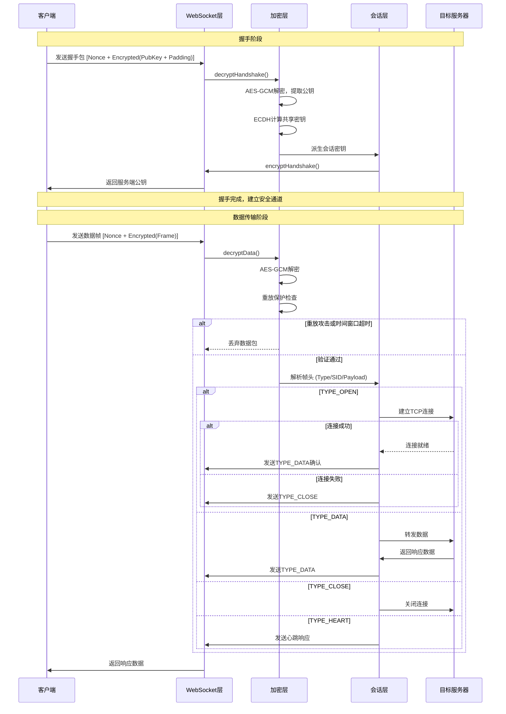

# SSP (Simple Stealth Protocol) 协议说明

## 概述

SSP 是一个基于 WebSocket over TLS (WSS) 的应用层代理协议，采用混合密钥协商和 AEAD 加密，提供前向安全性、重放保护和抗 DPI 探测能力。

---

## 服务端视角 (Workers)

### 1. 协议常量

```javascript
const PROTOCOL = {
  TYPE_DATA: 0x01,    // 数据传输
  TYPE_OPEN: 0x02,    // 打开流
  TYPE_CLOSE: 0x03,   // 关闭流
  TYPE_HEART: 0x05,   // 心跳包
  HEADER_LEN: 8,      // 帧头长度
};

const CONFIG = {
  REPLAY_WINDOW_SEC: 300,      // 重放保护时间窗口 5分钟
  HANDSHAKE_TIMEOUT: 10000,    // 握手超时 10s
  CHUNK_SIZE: 16 * 1024,       // 数据分片 16KB
};
```

### 2. 密钥派生体系

```
PSK
  │
  ├─[HKDF salt=16零字节, info="sspv1.4-handshake"]→ handshakeKey (AES-256-GCM)
  │
  └─ 作为 salt 用于会话密钥派生
       │
       X25519 ECDH (临时密钥交换)
       │
       sharedSecret (256 bit)
       │
       ├─[HKDF salt=PSK, info="sspv1.4-salt"]→ sessionSalt (128 bit)
       │    └─ sessionSalt[0:4] → fixedSuffix (Nonce 后缀)
       │
       ├─[HKDF salt=PSK, info="sspv1.4-tx\0<sessionSalt>"]→ txKey (AES-256-GCM)
       └─[HKDF salt=PSK, info="sspv1.4-rx\0<sessionSalt>"]→ rxKey (AES-256-GCM)
```

> 注意：服务端 txKey 用于加密发送，rxKey 用于解密接收。客户端相反。

### 3. 握手流程

```
Client                              Server
  │                                   │
  │──[Nonce + Enc(PubKey + Pad)]─────>│  使用 handshakeKey 解密
  │                                   │  提取 32 字节 X25519 公钥
  │                                   │  ECDH 计算 sharedSecret
  │<──[Nonce + Enc(PubKey + Pad)]─────│  返回服务端公钥
  │                                   │  派生 sessionSalt, txKey, rxKey
  │◀──── 安全通道建立完成 ────────────▶│
```

### 4. 数据传输帧结构

#### 4.1 网络传输格式
```
┌─────────────────────────────────────────────────────────────────┐
│                    WebSocket Binary Frame                     │
├──────────────┬─────────────────────────────────────────────────┤
│   Nonce      │              Ciphertext                        │
│  (12 Bytes)  │  (AES-GCM Ciphertext + 16 Bytes Auth Tag)     │
├──────────────┼─────────────────────────────────────────────────┤
│ Counter(8B)  │  [ Inner Plaintext 的加密结果 ]                │
│ + Suffix(4B) │                                               │
└──────────────┴─────────────────────────────────────────────────┘
```

#### 4.2 内层明文结构
```
┌──────┬──────┬─────────────┬──────────────┬───────────────┬──────────────┐
│ Type │ SID  │  Timestamp  │ Payload Len  │    Payload    │   Padding    │
│ 1字节 │ 1字节 │   4字节     │    2字节      │    N字节       │  0~127字节   │
└──────┴──────┴─────────────┴──────────────┴───────────────┴──────────────┘
```

### 5. 数据处理

**加密发送 (`packAndEncrypt`)**：
1. 构建 8 字节帧头 (Type + SID + Timestamp + PayloadLen)
2. 添加 0-127 字节随机填充（抗 DPI）
3. 构造 12 字节 Nonce (8B 计数器 + 4B fixedSuffix)
4. AES-256-GCM 加密，输出 `Nonce + Ciphertext`

**解密接收 (`decryptData`)**：
1. 提取前 12 字节 Nonce，用 `rxKey` 解密剩余数据
2. 重放保护检查（时间窗口 + Nonce 滑动窗口）
3. 返回内层明文

### 6. 重放保护机制

双层防护：

**时间窗口检查**：帧 Timestamp 与当前时间差超过 ±300 秒则拒绝。

**Nonce 滑动窗口**：64 位位图跟踪最近 64 个 Nonce，检测到重复 Nonce 则判定为重放攻击。

### 7. 流管理

**打开流 (`_handleOpen`)**：
1. 解析 Payload：按 `\x00` 截断，再按 `|` 分割目标地址
2. 合并 `fallbackIPs` 作为备用目标
3. 依次尝试连接，成功后保存流并发送空 DATA 帧确认
4. 全部失败则发送 CLOSE 帧

**数据转发 (`_handleData`)**：将 Payload 写入对应流的 socket writer。

**数据泵 (`_pumpStream`)**：从 socket reader 读取数据，超过 16KB 分片发送，流关闭时清理资源。

### 8. 服务端处理流程图



---

## 客户端视角 (Go 实现)

### 1. 协议常量

```go
const (
    TYPE_DATA     = 0x01
    TYPE_OPEN     = 0x02
    TYPE_CLOSE    = 0x03
    TYPE_HEART    = 0x05
    NONCE_SIZE    = 12
    TAG_SIZE      = 16
    timeWindowSec = 300
)
```

### 2. 密钥派生

与服务端相同 HKDF 派生流程，但 **tx/rx 命名相反**：

```go
// 客户端发送用 rxKey (对应服务端接收)
rxKey = deriveKey(sharedSecret, salt, "sspv1.4-tx")
// 客户端接收用 txKey (对应服务端发送)
txKey = deriveKey(sharedSecret, salt, "sspv1.4-rx")
```

### 3. 握手流程

1. 生成 X25519 密钥对，用 `handshakeKey` 加密公钥 + 随机填充 (16-47 字节)，发送
2. 读取服务端响应，解密提取服务端公钥
3. ECDH 计算共享密钥
4. 派生会话密钥，创建 AEAD 对象，清除敏感数据

### 4. 数据传输

**加密**：构建 8 字节帧头 + 随机填充 → 构造 Nonce (8B 计数器 + 4B salt) → AES-GCM 加密。

**解密**：提取 Nonce 解密 → 重放检查 → 解析帧。

### 5. 重放保护 (分片优化)

Go 客户端使用 **32 分片 map** 实现重放保护，每个分片独立锁，定期清理过期条目（超过 5 分钟）。与服务端的 64 位位图滑动窗口不同。

### 6. OPEN 载荷

```
primaryTarget|fallback1|fallback2\x00<随机填充>
```

最小长度 256 字节，不足则补 `0x00` 分隔符 + 随机字节。

---

## 安全特性总结

### 1. 前向安全性
- X25519 ECDH 提供完美前向安全性
- 即使 PSK 泄露，历史会话无法解密

### 2. 重放攻击防护
- 时间窗口检查 (±300 秒)
- 服务端：Nonce 滑动窗口 (64 位位图)
- 客户端：分片 map 存储 (32 分片)

### 3. 抗 DPI 探测
- 握手包随机填充 (16-47 字节)
- 数据包随机填充 (0-127 字节)
- 流量长度随机化

### 4. 完整性保护
- AES-256-GCM 提供认证加密
- 16 字节认证标签防篡改

### 5. 流复用
- 单 WebSocket 连接支持最多 256 个并发流
- Stream ID 区分不同 TCP 连接
- 独立的流生命周期管理
